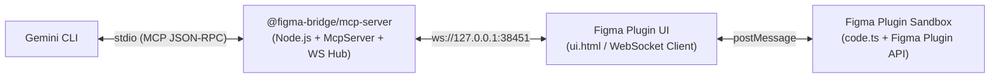

# Implementation Plan: Figma Local MCP Bridge (`figma-bridge`)

## Goal Description
Build a self-hosted, local-only Model Context Protocol (MCP) bridge in **TypeScript** inside `/Users/choi/Disk/development/project/figma-bridge`. It connects **Gemini CLI** to **Figma Desktop** on a **Free/Starter Figma account** without requiring Figma Dev Mode, a paid seat, personal access tokens, or third-party bridge repositories.



---

## User Review Required

> [!IMPORTANT]
> **Security & Transport Design**
> - The WebSocket server will bind strictly to `127.0.0.1` (loopback only, default port `38451`) so it is never exposed to the local network.
> - In `packages/figma-plugin/manifest.json`, `networkAccess.allowedDomains` is set to `["none"]` and localhost WebSocket access is declared via `devAllowedDomains` (`ws://127.0.0.1:38451`, `ws://localhost:38451`), ensuring zero external network traffic.
> - All MCP server diagnostics log exclusively to `stderr` (`console.error`), keeping `stdout` strictly clean for Gemini CLI's `stdio` JSON-RPC stream.

> [!NOTE]
> **Operational Constraints**
> - Figma Desktop must be open with the target `.fig` / design file loaded and the local development plugin running (`Plugins -> Development -> Figma Local Bridge`).
> - This MVP focuses on **read & visual export tools** (inspecting layout, styles, variables/tokens, and exporting PNG/SVG screenshots) so Gemini CLI can generate accurate frontend code safely without mutating your Figma file.

---

## Open Questions

1. **Read-only MVP vs. Canvas Write Tools:** Should the initial MVP stay read-only (`get_bridge_status`, `get_selection`, `get_node`, `export_node_image`, `get_local_tokens`), or do you also want basic canvas creation/mutation tools later?
2. **Gemini CLI Config Registration:** After building the project, would you like `figma-bridge` registered automatically in `/Users/choi/.gemini/settings.json` (creating it if absent), or just documented in `README.md`?

---

## Proposed Changes

Directory `/Users/choi/Disk/development/project/figma-bridge` is the workspace root. The project will be structured as an **npm workspaces** TypeScript monorepo (`Node v22.22.2`, `npm 10.9.7`).

### Workspace Root (`/Users/choi/Disk/development/project/figma-bridge`)

#### [NEW] package.json
- Configure `"private": true`, `"type": "module"`, and `"workspaces": ["packages/*"]`.
- Root scripts: `build`, `typecheck`, `test` orchestrating all workspace packages.

#### [NEW] tsconfig.base.json
- Strict TypeScript defaults (`target: "ES2022"`, `strict: true`, `skipLibCheck: true`).

#### [NEW] .gitignore & README.md
- Ignore `node_modules/`, `dist/`, `*.tsbuildinfo`.
- Document build commands, Figma Desktop plugin import steps, and `~/.gemini/settings.json` setup.

---

### Shared Protocol Package (`packages/shared`)

#### [NEW] packages/shared/package.json & tsconfig.json
- Defines `@figma-bridge/shared` exporting shared request/response types so the MCP server and Figma plugin stay type-safe in lockstep.

#### [NEW] packages/shared/src/protocol.ts
- Define discriminated request/response envelopes over WebSocket:
  - `BridgeMethod`: `'get_status' | 'get_selection' | 'get_node' | 'export_node_image' | 'get_local_tokens'`
  - `BridgeRequest`: `{ id: string; method: BridgeMethod; params?: Record<string, unknown> }`
  - `BridgeResponse`: `{ id: string; ok: true; result: unknown } | { id: string; ok: false; error: { code: string; message: string } }`
- Define serialized DTO interfaces (`SerializedNode`, `SerializedPaint`, `SerializedTextStyle`, `SerializedTokens`, `ExportedImage`, `BridgeStatus`) kept compact to avoid wasting LLM context tokens.

---

### MCP Server + WebSocket Hub (`packages/mcp-server`)

#### [NEW] packages/mcp-server/package.json & tsconfig.json
- Dependencies: `@modelcontextprotocol/sdk`, `ws`, `zod`, `@figma-bridge/shared`.
- Dev dependencies: `@types/node`, `@types/ws`, `tsx`, `typescript`.
- `bin` entry pointing to `./dist/index.js` (`#!/usr/bin/env node`).

#### [NEW] packages/mcp-server/src/bridge-hub.ts
- Encapsulates the `WebSocketServer` bound to `127.0.0.1` (`FIGMA_BRIDGE_PORT` env var, default `38451`).
- Tracks the active Figma plugin socket, correlates outgoing requests with UUID `id`, enforces configurable timeouts (default `15000ms`), and cleans up pending promises on socket disconnect.
- Handles `EADDRINUSE` cleanly with actionable error messages to `stderr`.

#### [NEW] packages/mcp-server/src/server.ts & index.ts
- Creates `McpServer` (`name: "figma-bridge"`, `version: "0.1.0"`) connected via `StdioServerTransport`.
- Registers 5 focused MCP tools with `zod` schemas:
  1. `get_bridge_status`: Reports whether Figma Desktop plugin is connected, current file name, current page name, and selection count.
  2. `get_selection`: Returns serialized node trees for currently selected layers (`depth` default `4`, `includeHidden` default `false`).
  3. `get_node`: Reads any node subtree by `nodeId` (`depth` default `4`).
  4. `export_node_image`: Exports target `nodeId` (or current selection) as `PNG` (returned as MCP `image` content block so multimodal Gemini CLI can inspect the visual UI directly) or `SVG` text (`scale` default `2`).
  5. `get_local_tokens`: Extracts local paint styles, text styles, effect styles, and local variables/collections.

#### [NEW] packages/mcp-server/test/bridge-hub.test.ts
- Uses Node's built-in `node:test` and `node:assert` to test:
  - Request/response round-trip against a real in-process WebSocket mock plugin client.
  - Error propagation when no plugin is connected.
  - Timeout behavior and cleanup when plugin disconnects mid-request.

---

### Figma Desktop Plugin (`packages/figma-plugin`)

#### [NEW] packages/figma-plugin/package.json & tsconfig.json
- Dev dependencies: `@figma/plugin-typings`, `esbuild`, `typescript`, `@figma-bridge/shared`.
- Build script bundles `src/code.ts` -> `dist/code.js` (IIFE/ES2017 target compatible with Figma's QuickJS sandbox) and builds/copies `ui.html` with inlined `ui.ts` logic into `dist/ui.html`.

#### [NEW] packages/figma-plugin/manifest.json
```json
{
  "name": "Figma Local Bridge",
  "id": "figma-local-bridge-dev",
  "api": "1.0.0",
  "main": "dist/code.js",
  "ui": "dist/ui.html",
  "editorType": ["figma"],
  "documentAccess": "dynamic-page",
  "networkAccess": {
    "allowedDomains": ["none"],
    "devAllowedDomains": [
      "ws://127.0.0.1:38451",
      "ws://localhost:38451"
    ]
  }
}
```

#### [NEW] packages/figma-plugin/src/serializer.ts & code.ts
- Implements `get_status`, `get_selection`, `get_node` (using `figma.getNodeByIdAsync`), `export_node_image` (using `node.exportAsync`), and `get_local_tokens` (using `figma.getLocalPaintStylesAsync`, `figma.getLocalTextStylesAsync`, `figma.getLocalEffectStylesAsync`, and `figma.variables.getLocalVariablesAsync` / `getLocalVariableCollectionsAsync`).
- Serializes layout properties (`layoutMode`, `primaryAxisAlignItems`, `counterAxisAlignItems`, `itemSpacing`, padding, `absoluteBoundingBox`), fills, strokes, corner radius, opacity, effects, and text properties (`characters`, `fontName`, `fontSize`, `lineHeight`, `letterSpacing`), while stripping noisy internal Figma fields.

#### [NEW] packages/figma-plugin/src/ui.html & ui.ts
- Compact plugin UI (`width: 280, height: 150`) showing connection status (`Connected` / `Reconnecting...`), configurable port (default `38451`), and a manual `Reconnect` button.
- Auto-reconnects on socket close with backoff and relays JSON frames between WebSocket and `parent.postMessage({ pluginMessage: ... }, "*")`.

---

## Verification Plan

### Automated Tests
After implementation, run a single chained verification command from `/Users/choi/Disk/development/project/figma-bridge`:
```bash
npm run typecheck && npm run build && npm test
```
- `typecheck`: Ensures strict TypeScript compilation passes across `shared`, `mcp-server`, and `figma-plugin`.
- `build`: Produces `packages/mcp-server/dist/index.js`, `packages/figma-plugin/dist/code.js`, and `packages/figma-plugin/dist/ui.html`.
- `test`: Executes `node --test` integration tests verifying the WebSocket bridge correlation, timeout, disconnect, and MCP tool handlers.

### Manual Verification
1. Open **Figma Desktop** -> open any local or cloud `.fig` file -> `Plugins` -> `Development` -> `Import plugin from manifest...` -> select `/Users/choi/Disk/development/project/figma-bridge/packages/figma-plugin/manifest.json`.
2. Register `figma-bridge` in `~/.gemini/settings.json` pointing to `node /Users/choi/Disk/development/project/figma-bridge/packages/mcp-server/dist/index.js`.
3. Launch `gemini`, run `/mcp` to confirm the 5 Figma tools appear.
4. Run the plugin inside Figma Desktop (verify UI shows `Connected`), select a UI frame, and prompt Gemini CLI to call `get_selection` + `export_node_image` and generate code from the selection.
